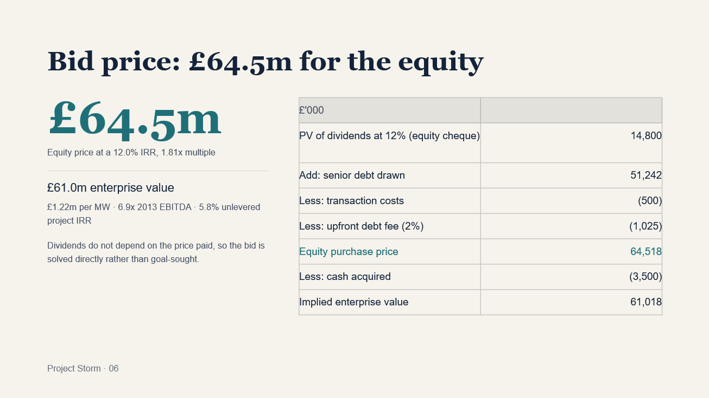
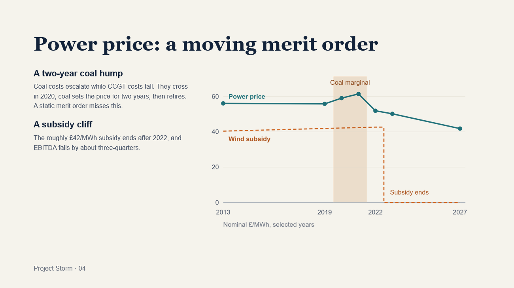
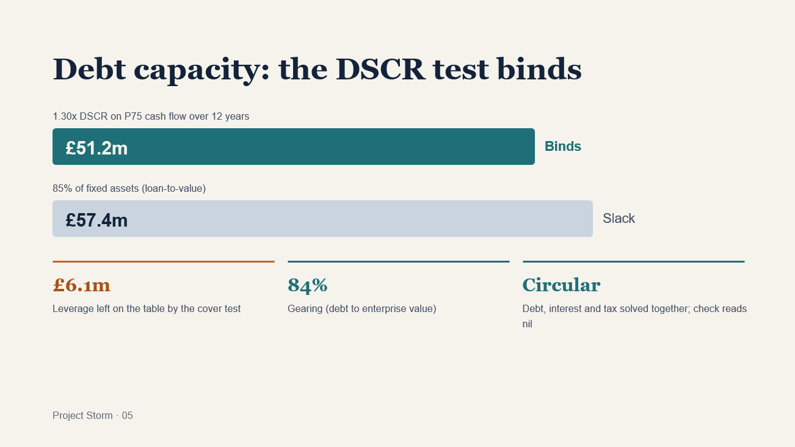
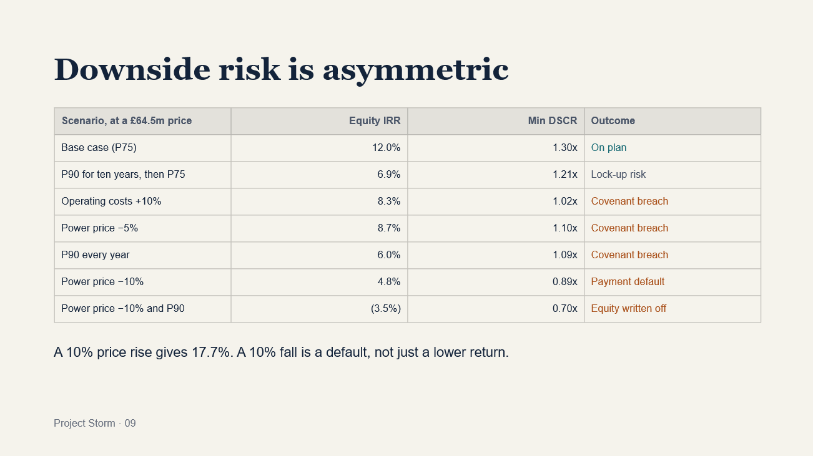

# Project Storm — Windfarm Acquisition Valuation & Debt Structuring

A full acquisition model for a 50 MW operational windfarm, valued from the perspective of an infrastructure investor buying 100% of the equity from a balance-sheet-constrained owner. The model builds the power price from a merit-order dispatch, sizes and sculpts senior debt, solves the debt–interest–tax circularity, and stress-tests the result to a bid recommendation. Built in Excel.

The headline finding is a **bid of £64.5m for the equity (implied EV £61.0m, £1.22m/MW) at a 12.0% equity IRR**, to be treated as a ceiling. The price is set by the lenders, not the equity hurdle: a 1.30x DSCR test caps senior debt £6.1m below what loan-to-value allows, and at 84% gearing a 10% fall in power prices is a payment default rather than a lower return.

> **Note on data.** Project Storm, the vendor, the investor and all associated figures are illustrative and constructed for this case study. This is not a live mandate and does not represent any real project, fund or transaction. Any resemblance to an actual entity is coincidental.

---

## Contents

| File | What it is |
|---|---|
| `Project_Storm_Valuation_Model.xlsx` | The model — assumptions, merit-order price stack, debt and tax schedules, statements, analysis and sensitivities |
| `Project Storm — Valuing a 50MW Operational Windfarm.pptx` | 10-slide deal review presentation |
| `Project_Storm_Valuation_Memo.pdf` | Written valuation memo (the content of this README as a document) |
| `Images` | Slide exports used below |

---

## Summary of results

| Analysis | Result |
|---|---|
| Bid price for 100% of the equity | **£64.5m** (implied EV £61.0m, £1.22m/MW) |
| Downside: P90 output for ten years, then P75 | Equity IRR falls from 12.0% to **6.9%** |
| Exit: sale to an infrastructure fund after two years at an 11% price | **13.2%** IRR |
| Power purchase agreement | Value-neutral at a **~4%** discount to the forward curve |
| Twelve-year amortising LIBOR swap | **1.64%** (4.64% all-in) |
| 30% interest deductibility cap | **Nil** impact on price |
| Five-year subordinated loan at 9% | Equity IRR **13.9%** (+195bps) |

---

## The case

An investor is bidding for an operating windfarm whose owner is balance-sheet constrained, has been unable to raise project finance, and must close by 31 December 2012, keeping the economic benefit of the asset to that date. The investor targets a 12% buy-and-hold equity IRR, with the option to sell down to a lower-return infrastructure fund after a few years.

| Assumption | Value |
|---|---|
| Installed capacity | 50 MW, operating since 1 January 2008 |
| Residual economic life | 15 years (to 2027) |
| Production | P75 2,500 hours (125 GWh p.a.); P90 2,350 hours |
| Power price | Merit order of CCGT, coal and renewables against demand of 320 TWh (2012), growing 0.25% p.a. to 2015 and 0.5% thereafter |
| Subsidy | £40/MWh (2012), escalating at CPI − 1.5%, for 15 years from first operation (ends 2022) |
| Operating costs | £50k/MW fixed + £5/MWh variable, escalating at CPI + 0.25% |
| CPI | 2.5% to 2015, 2.0% thereafter |
| Corporate tax | 25%; interest deductibility capped at 30% of EBITDA, excess carried forward |
| Transaction costs | £0.5m (non-depreciable) |

Lender terms: 12-year tenor, LIBOR + 300bps, 200bps upfront fee, sized at the lower of 85% of fixed assets and a 1.30x DSCR on P75 cash flow (excluding working capital), with 85% of outstanding principal hedged.

---

## Model architecture

Six tabs, with workings separated from outputs so every number traces back to an input.

**Instructions** — model map, colour conventions, the location of every check, and key observations.

**Assumptions** — every input on one page, colour-coded. A production switch runs P75, P90, or P90 for ten years then P75.

**Calcs** — inflation indices; a dynamic merit-order stack that re-ranks plant by cost each year to find the marginal unit; revenue and opex; working capital derived from the opening balance sheet; the sculpted senior debt schedule; swap pricing; and the tax computation with the interest cap and carry-forward.

**Output** — P&L, cash flow, balance sheet, the valuation bridge and sources & uses at close.

**Analysis** — headline results plus the downside case, two-year exit, swap rate, interest-cap test and subordinated loan, each with full workings.

**Sensitivities** — bid price against target return, interest-cap levels, operating shocks, and a PPA grid of discount to curve against DSCR floor.

Conventions: blue text is a hardcoded input, black a formula, green a cross-sheet link, yellow fill a key lever. All amounts in £'000 unless stated; GWh × £/MWh gives £'000 directly.

### Built-in checks

The model validates itself rather than relying on the reader to spot an error:

- Balance sheet balances in every year (Output row 86)
- Sources equal uses at close (Output D101)
- Senior debt drawn equals the amount the 1.30x DSCR test supports, with DSCR proven constant across the tenor (Calcs D100, D118)
- Subordinated loan drawn equals the amount 1.20x cover supports (Analysis D165)

Debt size, interest and tax are mutually dependent. Rather than switch on iterative calculation, the sculpted principal profile and sub-loan quantum are solved outside the sheet and entered as inputs, each with a live check beside it that must read nil.

---

## Findings

### 1. The merit order moves — and creates a price hump

Supply must clear demand, so the marginal plant sets the price. The ranking is not static: coal costs escalate while CCGT costs fall, and the two cross in 2020. At that point renewables plus CCGT fall just short of demand, coal sets the price for two years, and then coal retires and CCGT takes over again. A static merit order would miss the hump.

| Year | Marginal plant | Real (£/MWh) | CPI index | Nominal (£/MWh) | Subsidy (£/MWh) |
|---|---|---:|---:|---:|---:|
| 2013 | CCGT | 54.73 | 1.0250 | 56.09 | 40.40 |
| 2019 | CCGT | 47.90 | 1.1657 | 55.83 | 42.04 |
| 2020 | Coal | 49.68 | 1.1890 | 59.07 | 42.25 |
| 2021 | Coal | 50.67 | 1.2128 | 61.45 | 42.46 |
| 2022 | CCGT | 41.97 | 1.2370 | 51.92 | 42.68 |
| 2023 | CCGT | 39.78 | 1.2617 | 50.20 | ends |
| 2027 | CCGT | 30.64 | 1.3658 | 41.84 | — |

The second shape in the curve is the subsidy cliff: the ~£42/MWh subsidy ends after 2022 and EBITDA falls by about three-quarters.

### 2. The DSCR covenant binds, not the gearing cap

| Test | Capacity | Status |
|---|---:|---|
| 1.30x DSCR on P75 CFADS over 12 years | £51.2m | **Binds** |
| 85% of fixed assets | £57.4m | £6.1m of headroom |

Debt is sculpted to a constant 1.30x, which maximises the facility for a given cover level. Gearing settles at 84% of enterprise value.

### 3. The bid is solved directly, not goal-sought

Dividends do not depend on the price paid — the price only affects the day-one cheque — so the equity cheque is simply the present value of dividends at 12%.

| £'000 | |
|---|---:|
| PV of dividends 2013–27 at 12% (= equity cheque) | 14,800 |
| Add: senior debt drawn | 51,242 |
| Less: transaction costs | (500) |
| Less: upfront debt fee at 2.00% | (1,025) |
| **Equity purchase price payable to vendor** | **64,518** |
| Less: cash acquired | (3,500) |
| **Implied enterprise value** | **61,018** |

Equity IRR 12.0% · money multiple 1.81x · EV/2013 EBITDA 6.9x · gearing 84% · unlevered project IRR 5.8% · equity 24% of price. The price sits £7.4m below the vendor's £71.9m book equity.

| Target equity IRR | Equity cheque | Bid price | Implied EV |
|---|---:|---:|---:|
| 10.0% | 16,055 | 65,772 | 62,272 |
| 11.0% | 15,403 | 65,121 | 61,621 |
| **12.0%** | **14,800** | **64,518** | **61,018** |
| 13.0% | 14,241 | 63,958 | 60,458 |
| 14.0% | 13,721 | 63,438 | 59,938 |

Four hundred basis points of required return moves the bid by only £2.3m.

### 4. Downside — P90 for ten years, then P75

Equity IRR falls from 12.0% to **6.9%**; the multiple from 1.81x to 1.46x. A 6% volume loss removes 42% of the equity return, because debt service is fixed and takes the first £6.4m of cash — the whole shortfall lands on the residual claim.

| Year | EBITDA base | EBITDA P90 | DSCR | Dividend |
|---|---:|---:|---:|---:|
| 2013 | 8,851 | 8,166 | 1.23x | 4,964 |
| 2016 | 8,897 | 8,197 | 1.22x | 1,382 |
| 2019 | 8,529 | 7,839 | 1.21x | 1,301 |
| 2022 | 7,863 | 7,201 | 1.21x | 1,179 |

£'000. 2013 includes the £3.5m opening cash released.

Minimum cover is 1.21x — no payment default. But cover sits below the 1.30x sizing case in every year, so a distribution lock-up at or above 1.20x would be within a whisker of tripping, and a lock-up traps cash rather than merely reducing it. Worth negotiating the lock-up at 1.15x and confirming covenant tests on P75 rather than actual production.

### 5. Exit after two years

An infrastructure fund buys the equity at 31 December 2014 on the same base case, assumes the existing debt and prices to an 11% levered return.

| £'000 | |
|---|---:|
| PV of dividends 2015–27 at 11% | 11,062 |
| Add: senior debt outstanding | 42,335 |
| Enterprise value at exit | 53,397 |
| Exit fee at 0.25% of EV | (133) |
| **Net equity proceeds** | **10,929** |

| Investor cash flows | 2012 | 2013 | 2014 |
|---|---:|---:|---:|
| Total | (14,800) | 5,408 | 12,842 |

A two-year IRR of **13.2%** against 12.0% held to term — +120bps, on a 1.23x multiple. The exit equity value of £11.1m is below the £14.8m invested; that is not value destruction but a depleting 15-year annuity from which £7.3m has already been drawn. Most of the return comes from dividend yield and deleveraging, not multiple expansion.

### 6. The financing drives the value — and a PPA is the lever

Moving the DSCR floor from 1.30x to 1.15x is worth **£1.9m** of price — almost as much as the full 400bps range of hurdle rates.

A PPA would replace merchant electricity revenue — about 58% of the top line to 2022 and all of it thereafter — with a contracted price. Any PPA is struck at a discount to the forward curve, because the offtaker is paid to absorb price and volume risk, and that discount reduces EBITDA directly. Against it, contracted revenue supports more debt: lenders size merchant wind at around 1.30x but will lend against a strong PPA at 1.15–1.20x. Since the DSCR test is what binds, relaxing it converts straight into purchasing power. Each 5% of discount costs roughly £2.5m, so a PPA is value-neutral at a **~4% discount**.

| Discount to curve | DSCR floor 1.30x | 1.20x | 1.15x |
|---|---:|---:|---:|
| 0% (at the curve) | 64,518 | 65,926 | 66,438 |
| 5% | 62,014 | 63,362 | 64,128 |
| 10% | 59,510 | 60,798 | 61,530 |
| 15% | 57,006 | 58,234 | 58,932 |

Bid price at an unchanged 12% equity IRR, £'000.

**Benefits.** More and cheaper debt (a lower DSCR floor, a tighter margin, a longer tenor). It removes the dominant risk: merchant exposure is what takes cover to 1.21x under P90 and to 0.89x on a 10% price fall. A PPA running past 2022 is the only structural answer to the subsidy cliff, and contracted assets clear at lower returns with infrastructure buyers, widening the exit.

**Downsides.** The discount is permanent value given away, and beyond ~4% it exceeds the financing gain. It forgoes upside — coal sets the price at £61/MWh in 2020–21, and a 10% price rise is worth 570bps of equity IRR on a merchant basis. And it brings counterparty, term and shape risk: a PPA shorter than the debt leaves a merchant tail, and a fixed-volume structure means a P90 year forces purchases in the market to cover the shortfall.

### 7. Interest rate hedge

Hedging 85% of a reducing balance is an amortising swap, so the fixed rate is the notional-weighted average of the LIBOR forwards discounted at LIBOR — not a simple average of the curve:

**Swap rate = Σ (Nₜ × Fₜ × DFₜ) ÷ Σ (Nₜ × DFₜ)**

The twelve-year amortising swap rate is **1.64%**, for an all-in fixed cost of **4.64%** including the 300bps margin. That is well below the 2.08% simple average of the curve, because the notional is largest in the early years when LIBOR is lowest; quoting the simple average would overstate the hedged cost by ~44bps.

A swap at these levels carries real break costs. On a two-year exit it must be novated or unwound, and in a falling-rate environment that is a cash cost to the investor. Size the unwind risk before committing to the full 85%.

### 8. Interest deductibility limitation

**Impact on the purchase price is nil; the 30% cap does not bind in any year.** This is structural: the DSCR test caps senior debt at £51.2m, and financing costs peak at £2.07m in 2013 against a £2.66m cap. Senior debt would have to reach roughly £65.9m, or 98% of fixed assets, before the cap bit.

| Year | EBITDA | 30% cap | Financing cost | Headroom |
|---|---:|---:|---:|---:|
| 2013 | 8,851 | 2,655 | 2,065 | 590 |
| 2021 | 9,115 | 2,735 | 867 | 1,868 |
| 2023 | 2,224 | 667 | 279 | 388 |

The tightest point, 2023, reflects the subsidy expiring, not leverage. The cap becomes live with higher-cost junior capital (the subordinated loan lifts 2013 financing costs to £2.63m against a £2.66m cap) and in an EBITDA shock, since it tightens exactly when trading is weak.

| Cap (% of EBITDA) | Senior debt | Bid price | Change |
|---|---:|---:|---:|
| No limit / 30% | 51,242 | 64,518 | — |
| 20% | 51,222 | 64,485 | (32) |
| 15% | 50,856 | 64,032 | (486) |
| 10% | 50,190 | 63,236 | (1,281) |
| Nil deduction | 48,859 | 61,646 | (2,872) |

Disallowed interest carries forward indefinitely and is modelled as recoverable against later headroom.

### 9. Subordinated loan

Five annuity payments at 9%, sized so post-senior cash covers the annuity 1.20x. The binding year is 2017, when post-senior cash is lowest (£1,921k), giving a maximum annuity of £1,601k and, at an annuity factor of 3.8897, a loan of **£6,227k**.

| At the same £64.5m price | Base | With sub-debt | Change |
|---|---:|---:|---:|
| Equity cheque | £14,800k | £8,573k | (£6,227k) |
| Equity IRR | 12.0% | 13.9% | +195bps |
| Money multiple | 1.81x | 2.25x | +0.44x |
| Or: bid at an unchanged 12% IRR | £64,518k | £65,316k | +£798k |

It is accretive because 9% is below the 12% hurdle and the interest is deductible, for an after-tax cost of about 6.75%. Use it either way — 195bps of return, or £0.8m more on price while still clearing 12%; in a competitive process the second is worth more. But total debt rises to £57.5m, the equity cushion falls to 13% of the price, and combined cover in 2017 is about 1.13x. It should not be committed in full without testing against the P90 case.

### 10. Downside risk is asymmetric

Holding the £64.5m price and committed debt constant and shocking the operating case:

| Scenario | Equity IRR | Min DSCR | Outcome |
|---|---:|---:|---|
| Base case (P75) | 12.0% | 1.30x | On plan |
| P90 for 10 years, then P75 | 6.9% | 1.21x | Lock-up risk |
| P90 every year | 6.0% | 1.09x | Covenant breach |
| Power price −5% | 8.7% | 1.10x | Covenant breach |
| Power price −10% | 4.8% | 0.89x | Payment default |
| Operating costs +10% | 8.3% | 1.02x | Covenant breach |
| Power price −10% and P90 | (3.5%) | 0.70x | Equity written off |

A 10% price rise gives 17.7%; a 10% fall defaults. At 84% gearing the lenders take the cash before the equity sees any of it.

---

## Recommendation

**Bid £64.5m as a ceiling and open nearer £60m.** The vendor cannot raise finance and must close by year end, and the price is already £7.4m below its book equity.

**Settle the financing before the price.** The DSCR test, not loan-to-value, caps the debt. Cover levels and a 1.15x distribution lock-up are worth more than haggling over the hurdle rate. The debt does the work.

**Go higher only with a PPA or a lower DSCR floor.** At 84% gearing the equity is thin; without contracted revenue, more price means more default risk.

### Diligence priorities before bidding

- **Load factor.** P75 is the whole valuation, and four years of operating history should exist. If actual production has run below P75, the price comes down.
- **Decommissioning.** No provision is modelled; a £2–3m liability in 2027 is worth ~£0.5m today.
- **Contracts and subsidy.** Grid connection, O&M and PPA terms, and confirmation the subsidy is grandfathered to 2022.
- **Deal structure.** Share versus asset purchase, and the availability of capital allowances.

---

## Modelling judgements

| Item | Treatment | Why |
|---|---|---|
| Base-case production | P75 (2,500 hours, 125 GWh p.a.) | Banks size on P75; P90 is the downside |
| Acquisition accounting | Share purchase, no step-up; PP&E £67.5m depreciating £4.5m p.a. | Carries the opening balance sheet forward; a step-up would not change the debt, since the DSCR test binds either way |
| Opening cash of £3.5m | Acquired and distributed in 2013 | Inside the priced balance sheet; excluded from sizing |
| Working capital | Receivable and payable days derived from the opening balance sheet (36.9 and 35.0), held flat | Ties to the balance sheet rather than inventing a ratio; excluded from sizing |
| Upfront fee | Capitalised against the debt, amortised over 12 years, deductible within the cap | Amortised-cost treatment; keeps the balance sheet balanced without an extra asset line |
| Repayment profile | Sculpted to a constant DSCR | Maximises debt for a given cover level |
| Terminal value | Nil | Economic life ends 2027 |
| Electricity demand | +0.25% p.a. to 2015, +0.5% thereafter | CCGT keeps ample headroom above demand in every year, so the clearing plant is robust to the demand path |

---

## Stated limitations

- **No decommissioning provision.** A £2–3m cost in 2027 would be worth roughly £0.5m today and would come straight off the bid.
- **Flat production.** P75 hours are held constant to 2027 with no availability or degradation profile; late-life cash flow is likely overstated.
- **Capital allowances follow book depreciation.** A conservative simplification; actual allowances could improve early-year tax.
- **Deterministic price path.** The merit order is a single central case; price risk is captured only through sensitivities.
- **Circularity solved outside the sheet.** The debt profile is a hardcoded, check-backed input, so changing operating assumptions requires re-solving it.

---

## Tools

Microsoft Excel — no add-ins, no macros, no external links.

---

## Author

Rosemary Waweru — Financial Analyst
[LinkedIn](https://www.linkedin.com/in/rosemary-waweru-85108b2a1) · [GitHub](https://github.com/ShikohWaweru)
